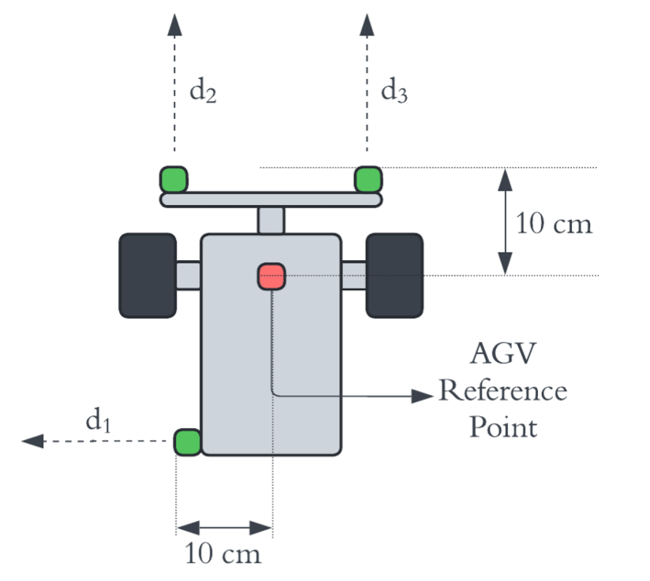
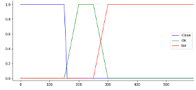
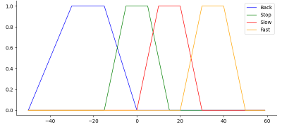
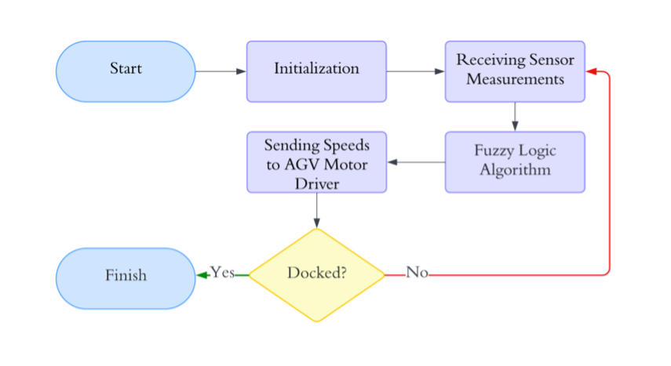
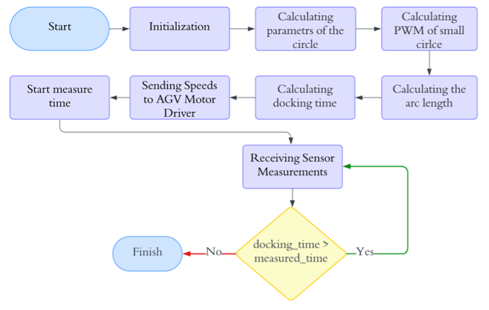
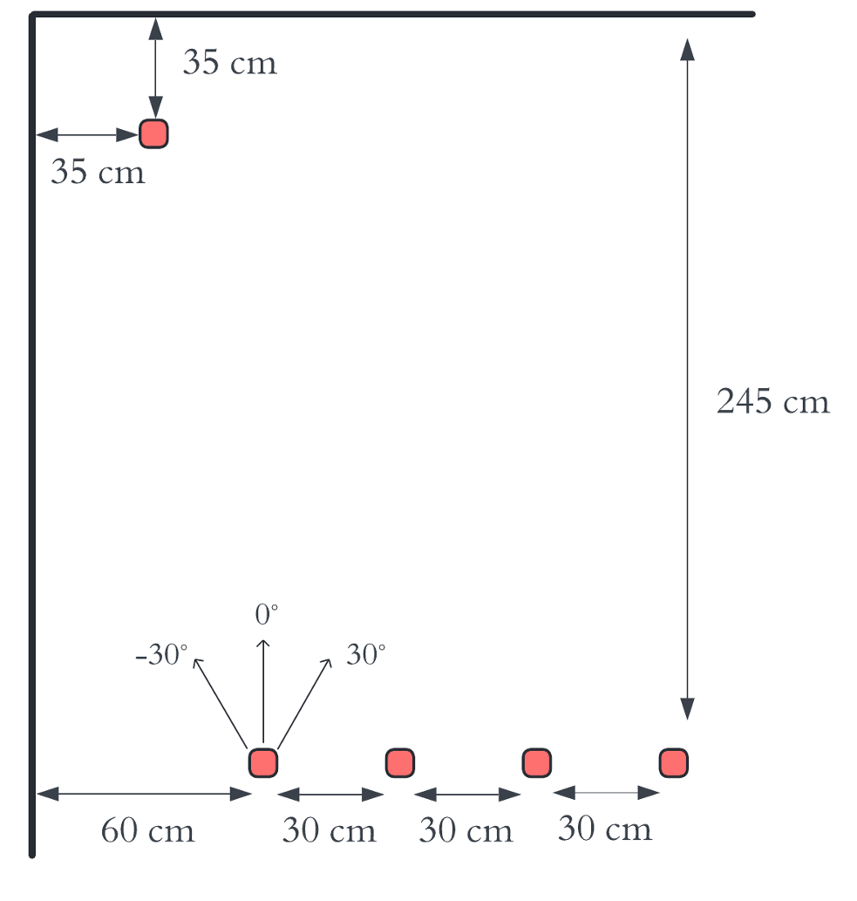
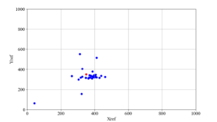
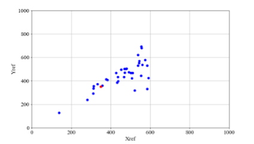

# Autonomous Docking of AGVs Using Fuzzy Logic

## Table of Contents
1. [Introduction](#introduction)  
2. [Methodology](#methodology)  
   - [Global and Local Navigation](#global-and-local-navigation)  
   - [Fuzzy Logic System](#fuzzy-logic-system)  
   - [Dead Reckoning Comparison](#dead-reckoning-comparison)  
3. [System Architecture](#system-architecture)  
4. [Implementation Details](#implementation-details)  
5. [Experiments and Results](#experiments-and-results)  
   - [Testing Environment](#testing-environment)  
   - [Performance Metrics](#performance-metrics)  
   - [Comparison](#comparison)  
6. [Conclusion](#conclusion)  
7. [Acknowledgments](#acknowledgments)  

---

## Introduction
Autonomous Guided Vehicles (AGVs) are widely used in modern industrial systems, especially in Industry 4.0 environments, to transport goods efficiently. The challenge of precise docking, which is crucial for subsequent production steps, requires advanced algorithms to overcome uncertainties in the environment.

This project introduces a fuzzy logic-based docking algorithm for AGVs that leverages low-cost single-beam laser proximity sensors. The method is evaluated against a traditional Dead Reckoning approach, demonstrating significant improvements in docking accuracy and reliability.

---

## Methodology

### Global and Local Navigation
AGVs operate in two phases:
1. **Global Navigation**: Guides the AGV from a distant starting point to the docking vicinity using technologies like GPS or SLAM.  
2. **Local Navigation**: Handles precise movements in confined spaces to achieve accurate docking.

This research focuses on local navigation, transitioning from broad guidance to fine adjustments near the docking point. By integrating a fuzzy logic system, the AGV adapts dynamically to environmental changes for optimal performance.

### Fuzzy Logic System
The fuzzy logic controller consists of three distinct stages:
1. **Approach to the Left Wall**: Aligns the AGV perpendicularly to a nearby wall.
2. **Rotation Toward the Docking Point**: Adjusts orientation for parallel movement.
3. **Parallel Movement and Docking**: Moves along the wall while fine-tuning position.

#### Key Features
- **Mamdani Inference System**: Intuitive and effective for modeling complex relationships.
- **Fuzzy Membership Functions**: Defined for input variables (e.g., distances) and output actions (e.g., motor speeds).
- **Dynamic Adaptation**: Real-time sensor feedback ensures continuous correction.

### Dead Reckoning Comparison
Dead Reckoning relies on cumulative calculations of position based on initial conditions and motion data. While it is computationally efficient, it suffers from error accumulation, especially in uncertain environments.

---

## System Architecture
The AGV system consists of:
- **Motor Driver**: L298N H-bridge circuit for controlling wheel movement.  
- **Distance Sensors**: Three single-beam proximity sensors provide real-time environmental data.  
- **Power Supply**: 9V, 2A laboratory power source.  
- **Control and Communication**: Python-based algorithms and UDP communication handle real-time navigation and data exchange.

  
  
<em>Figure 1: A descriptive caption for the image</em>

---

## Implementation Details

### Fuzzy Logic Algorithm
#### Membership Functions
- **Input Variables**:  
  - *Distances*: Classified as “Close,” “OK,” and “Far” based on trapezoidal membership functions.  
  - *Difference in Readings*: Indicates AGV's deviation from the optimal path.

  
  
<em>Figure 1: A descriptive caption for the image</em>

- **Output Variables**:  
  - *Motor Speeds*: Adjustments classified as “Back,” “Stop,” “Slow,” or “Fast.”

  
  
<em>Figure 1: A descriptive caption for the image</em>

#### Rule Base
Rules are defined as IF-THEN statements combining sensor data to control AGV movements. For example:
- If the distance to the left wall is “Close” and the front sensor reads “Far,” then adjust speed to “Slow.”

#### Fuzzy Logic Algorithm Flow
1. **Initialization**: Activates sensors and initializes the fuzzy controller.  
2. **Data Collection**: Gathers real-time sensor inputs.  
3. **Decision Making**: Applies fuzzy rules to determine the next action.  
4. **Movement Adjustment**: Controls motor speeds to navigate closer to the docking point.  
5. **Iteration**: Continuously repeats until docking is achieved.

  
  
<em>Figure 1: A descriptive caption for the image</em>

### Dead Reckoning Algorithm Flow
1. **Circle Calculation**: Determines optimal arcs for AGV movement.  
2. **Wheel Speed Adjustment**: Maintains proportional speeds for inner and outer wheels.  
3. **Stopping Condition**: Calculates travel time based on arc lengths and velocities.

  
  
<em>Figure 1: A descriptive caption for the image</em>

---

## Experiments and Results

### Testing Environment
The experiments were conducted in a controlled L-shaped environment with four starting positions:
- SP1: (600 mm, 2450 mm)  
- SP2: (900 mm, 2450 mm)  
- SP3: (1200 mm, 2450 mm)  
- SP4: (1500 mm, 2450 mm)

  
  
<em>Figure 1: A descriptive caption for the image</em>

Starting angles included -30°, 0°, and 30°, with three trials per configuration. The target docking point was (350 mm, 350 mm).

### Performance Metrics
- **Mean Error**: Distance from the target position.
- **Standard Deviation**: Variability in docking accuracy.
- **Angle Error**: Final alignment compared to the intended angle.

### Comparison
#### Fuzzy Logic Results
- **Mean Errors**:  
  - X-axis: 47 mm  
  - Y-axis: 39 mm  
  - Angle: 6°  
- **Standard Deviations**: Lower across all metrics compared to Dead Reckoning.

  
  
<em>Figure 1: A descriptive caption for the image</em>

#### Dead Reckoning Results
- **Mean Errors**:  
  - X-axis: 134 mm  
  - Y-axis: 124 mm  
  - Angle: 39°  
- **Observations**: Higher variability and greater dependency on initial conditions.

  
  
<em>Figure 1: A descriptive caption for the image</em>

---

## Conclusion
The fuzzy logic-based docking algorithm outperforms the Dead Reckoning method in terms of precision, adaptability, and error minimization. Its ability to dynamically adjust to environmental changes makes it ideal for industrial applications requiring high accuracy.

### Advantages of Fuzzy Logic
- Handles uncertainties effectively.  
- Reduces error accumulation.  
- Achieves consistent results across varying initial conditions.

### Limitations of Dead Reckoning
- Prone to cumulative errors.  
- Limited adaptability to environmental dynamics.  

---

## Acknowledgments
This research was supported by the Norway Grants 2014–2021 and the Polish Ministry of Science and Higher Education under the project "Automated Guided Vehicles Integrated with Collaborative Robots for Smart Industry Perspective" (Project Contract No. NOR/POLNOR/CoBotAGV/0027/2019-00).
